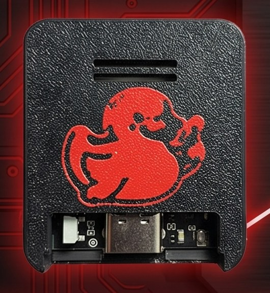

# 🦆 WiFi Duck

**Wireless keystroke-injection trainer — ESP32-S2 Mini**

The **WiFi Duck** is a hand-built wireless keystroke-injection device from P01yg107 Labs. Like the Kraken it looks like a USB keyboard to the host — but you send it commands over its own WiFi from a phone or laptop, through a simple web interface. It's a clean way to learn HID attacks and why USB input can't be trusted blindly.

🛒 **Buy one:** https://p01ylabs.com  ·  ▶ **Demo:** https://youtu.be/Fz9-gSyBDCg  ·  🏷️ **$25.00**

> ⚠️ **For education and authorized testing only.** See [docs/SAFETY.md](docs/SAFETY.md).

---

## Specs

| | |
|---|---|
| Board | ESP32-S2 Mini |
| Firmware | WiFiDuck (Spacehuhn) |
| Control | Web interface over the device's own WiFi access point |
| Scripting | DuckyScript, saved and run from the web UI |
| Case | 3D-printed PETG-CF with a flush two-colour duck inlay |

## Quick start

1. Plug the WiFi Duck into a computer **you own**.
2. On your phone or laptop, connect to its WiFi network (defaults in docs/SETUP.md).
3. Open a browser to the device's web interface.
4. Write or pick a DuckyScript payload and save it.
5. Press Run — the Duck types it on the host.

Full walkthrough: **[docs/SETUP.md](docs/SETUP.md)** · Usage & examples: **[docs/USAGE.md](docs/USAGE.md)** · Problems: **[docs/TROUBLESHOOTING.md](docs/TROUBLESHOOTING.md)**

## Firmware & credits

- **[WiFiDuck](https://github.com/SpacehuhnTech/WiFiDuck)** — the ESP32 wireless-HID firmware the device runs

This repo is the product documentation and companion material. Where upstream firmware is
used, please support and star the upstream project; firmware issues belong upstream.

## About P01yg107 Labs

Hand-built hardware for people learning offensive security. Every device is flashed and
bench-tested before it ships.

🌐 https://p01ylabs.com  ·  🐙 https://github.com/p0lygl07

---

© 2026 Joshua Burton (P01yg107 Labs). Documentation and original files licensed under the MIT License (see [LICENSE](LICENSE)).
Any upstream firmware remains the property of its respective authors, under their own licenses.
